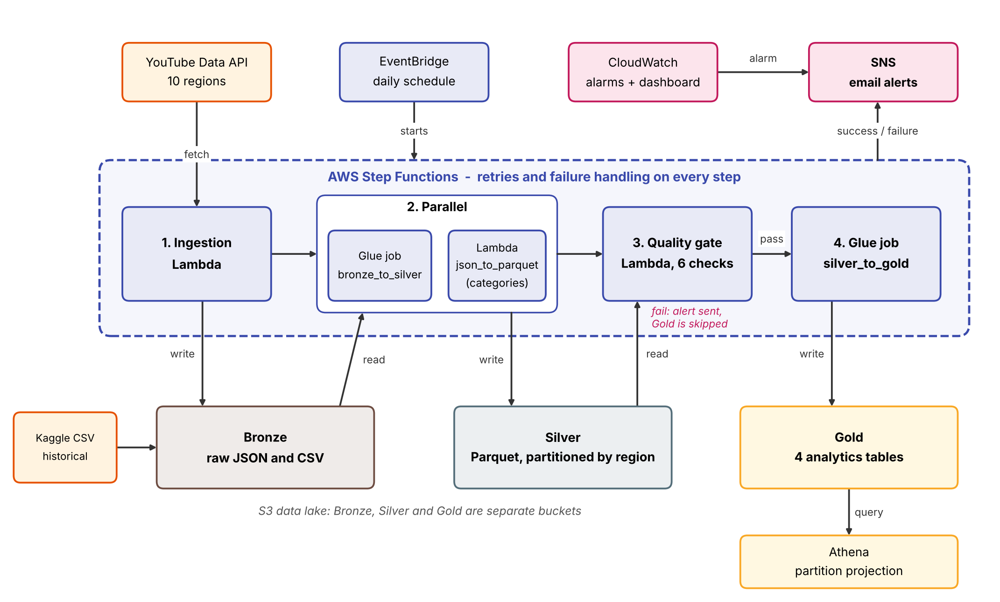

# YouTube Trending Data Pipeline

[](https://github.com/bahadirkoko/youtube-trending-pipeline/actions/workflows/ci.yml)

A serverless data pipeline on AWS. Every day it pulls the trending videos for 10 countries from
the YouTube Data API, cleans and validates them, and builds analytics tables you can query with
SQL in Athena. It follows the medallion pattern (Bronze → Silver → Gold) and everything is
defined as code with Terraform.



## What it does

| Stage | What happens |
|---|---|
| **Ingest** | A Lambda calls the YouTube API for each region and stores the raw JSON in the Bronze bucket. Historical Kaggle CSVs are loaded into Bronze too. |
| **Silver** | A Glue (PySpark) job cleans and deduplicates Bronze into typed Parquet partitioned by region. A Lambda converts the category reference data in parallel. |
| **Quality gate** | A Lambda runs six checks on Silver (row count, readable files, schema, null rates, value ranges, freshness). If any fail, Gold is skipped and an email is sent. |
| **Gold** | A second Glue job builds four analytics tables: `video_trending_history`, `trending_analytics`, `channel_analytics`, `category_analytics`. |
| **Query** | Athena reads Gold and Silver using partition projection, so no crawlers or `MSCK REPAIR` are needed. |
| **Orchestrate** | A Step Functions state machine runs all of this daily via EventBridge, with retries and failure handling. |
| **Monitor** | CloudWatch alarms (failed runs, Lambda errors, pipeline not running) and a dashboard, all alerting through SNS email. |

## Tech stack

- **Compute:** Lambda (Python 3.12), Glue 5.0 (PySpark)
- **Storage and query:** S3, Glue Data Catalog, Athena
- **Orchestration:** Step Functions, EventBridge
- **Alerts and monitoring:** SNS, CloudWatch
- **Infrastructure:** Terraform (modules, remote state in S3, separate `dev` and `prod` environments)
- **Quality:** pytest and moto (136 tests including real-Spark integration tests), ruff, pre-commit, GitHub Actions CI

## Repository layout

```text
infra/
  bootstrap/        remote state bucket
  modules/          one module per component (data_lake, ingestion, glue_jobs, ...)
  envs/dev/         the deployed environment
  envs/prod/        production settings, validated in CI but never applied
src/
  lambdas/          youtube_ingestion, json_to_parquet, data_quality
  glue_jobs/        bronze_to_silver.py, silver_to_gold.py
orchestration/      Step Functions definition (ASL template)
sql/
  ddl/              reference DDL for the Gold tables
  queries/          example Athena queries
tests/              unit and integration tests
scripts/            helper scripts (queries, backfill, log retention)
docs/               runbook and architecture notes
```

## Getting started

You need Python 3.12, Java 17 (for the Spark tests), Terraform 1.x, and an AWS account with
credentials configured.

```bash
make install                # create .venv with Python 3.12, install dependencies and git hooks
source .venv/bin/activate   # every other make target expects the venv to be active
make check                  # lint, terraform fmt, and all tests
make help                   # list every available command
```

See [`docs/development.md`](docs/development.md) for the full local setup, tests and pre-commit
hooks.

### Deploy to AWS

Everything deploys to **`us-east-1`**. The AWS SDK for pandas Lambda layer ARN in
`infra/envs/dev/main.tf` is region-specific, so another region also needs that ARN changed
(see the [layer list](https://aws-sdk-pandas.readthedocs.io/en/stable/layers.html)).

1. **Get a YouTube Data API key.** In the [Google Cloud Console](https://console.cloud.google.com/),
   create a project, enable **YouTube Data API v3** under *APIs & Services → Library*, then
   create an API key under *APIs & Services → Credentials*. The free quota (10,000 units a day)
   is far more than the pipeline uses.
2. **Download the historical data.** Get the
   [Trending YouTube Video Statistics](https://www.kaggle.com/datasets/datasnaek/youtube-new)
   dataset from Kaggle (free account needed) and put the ten `<RR>videos.csv` files
   (`USvideos.csv`, `GBvideos.csv`, ...) in `data/raw/`. The category JSON files are already in
   `data/reference/`. With the [Kaggle CLI](https://github.com/Kaggle/kaggle-api):
   `kaggle datasets download -d datasnaek/youtube-new -p data/raw --unzip`.
3. **Create the state bucket.** `cd infra/bootstrap && terraform init && terraform apply`.
4. **Point Terraform at it.** Replace the `bucket` value in `infra/envs/dev/backend.tf` with
   the `state_bucket_name` output from step 3. The value in the repo is the author's bucket and
   will not work for you.
5. **Deploy.** In `infra/envs/dev`: `cp terraform.tfvars.example terraform.tfvars`, set
   `alert_email` to your address, then `terraform init`, `terraform plan` and `terraform apply`.
   Click the SNS confirmation email that arrives.
6. **Store the API key** in Secrets Manager: `make set-secret` (input is hidden).
7. **Load the history** into Bronze: `make backfill` (`make backfill-dry` shows what it would
   upload).
8. **Run the pipeline once** by hand: `make pipeline-run`. It takes about 5 minutes and sends a
   success email.

After that it runs daily at 11:00 UTC. The schedule is controlled by the
`pipeline_schedule_enabled` variable. See [`docs/runbook.md`](docs/runbook.md) if anything fails.

### Query the data

```bash
make query Q=sql/queries/01_top_channels.sql
```

Example: the top channels by total peak views (a video's peak views counted once, because
YouTube view counts are cumulative):

| channel_title | videos_trended | total_trending_days | total_peak_views | top_video_title |
|---|---|---|---|---|
| ibighit | 9 | 80 | 271,753,404 | BTS (방탄소년단) 'FAKE LOVE' Official MV |
| ChildishGambinoVEVO | 1 | 25 | 225,211,923 | Childish Gambino - This Is America (Official Video) |
| Dude Perfect | 12 | 131 | 206,044,429 | Real Life Trick Shots 2 \| Dude Perfect |
| Marvel Entertainment | 16 | 125 | 204,282,789 | Marvel Studios' Avengers: Infinity War Official Trailer |
| Ed Sheeran | 5 | 47 | 169,017,417 | Ed Sheeran - Happier (Official Video) |

The older titles come from the historical Kaggle dataset (2017-2018) loaded into Bronze. New
rows from the daily API ingestion are added on top of it. See `sql/queries/` for six more
queries.


## Cost

About 4 cents per daily run, almost all of it the two Glue jobs (2 workers each). Lambda,
Step Functions, Athena and S3 are a few cents a month at this data size.

## Design decisions

- **Quality gate before Gold.** Bad data never reaches the analytics tables. The pipeline stops and
  alerts instead.
- **Partitioned by region, with partition projection.** Athena only scans the regions a query
  asks for, and new partitions are available immediately.
- **Plain PySpark on Glue, no Docker.** The jobs are normal Python files that run both on Glue and
  in the local test suite.
- **Contract tests.** Column lists exist in the Spark job, Terraform, DDL and quality gate. Tests
  fail if they drift apart.
- **`prod` is code only.** It shows the dev-to-prod promotion pattern without paying for a second
  deployment.

## Documentation

- [`docs/architecture.md`](docs/architecture.md): design decisions, failure modes and testing strategy
- [`docs/data-dictionary.md`](docs/data-dictionary.md): every Silver and Gold table, column by column
- [`docs/development.md`](docs/development.md): local setup, tests and making changes
- [`docs/runbook.md`](docs/runbook.md): operations, alerts, recovery and rebuild steps

## CI

Every push runs three GitHub Actions jobs: lint (ruff), tests (pytest with Java and Spark), and
`terraform fmt` plus `validate` for bootstrap, dev and prod. No AWS credentials are used in CI.
